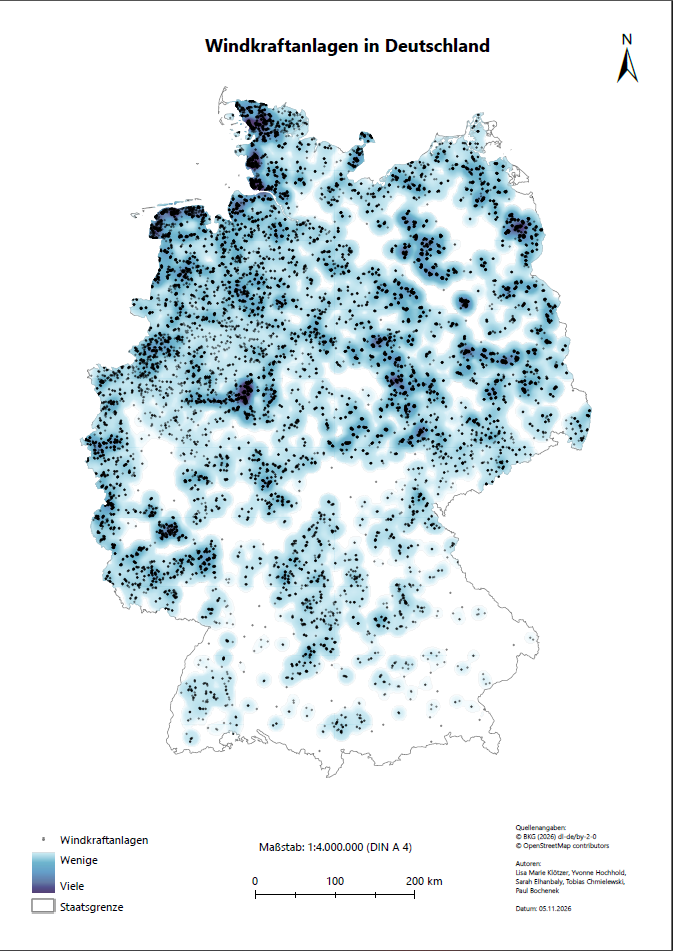
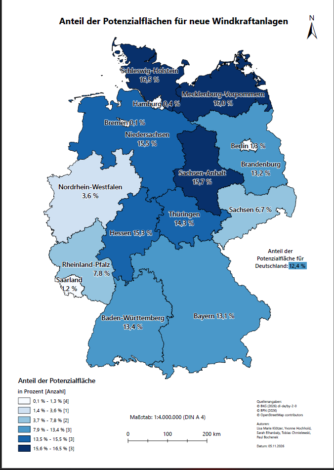

# Windenergiepotenzial in Deutschland
Untersuchung möglicher Standorte für Windkraftanlagen  im Gebiet der Bundesrepublik Deutschland mit ArcGIS Pro
# Windenergiepotenzial in Deutschland 🌬️🗺️

**Untersuchung möglicher Standorte für Windkraftanlagen im Gebiet der Bundesrepublik Deutschland mit ArcGIS Pro**

*(Spatial analysis of potential sites for wind turbines across Germany using ArcGIS Pro)*

---

## 🎯 Projektziel (Project Objective)
Ziel dieses GIS-Projekts ist die räumliche Standortanalyse zur Identifikation geeigneter Potenzialflächen für neue Windkraftanlagen in Deutschland unter Berücksichtigung geografischer, ökologischer und infrastruktureller Ausschluss- und Eignungskriterien.

---

## 🛠️ Verwendete Tools & Methoden (Tools & Methods)
* **Software:** Esri ArcGIS Pro
* **Geoprocessing & Analyse:** Buffer, Clip, Erase, Spatial Join, Overlay-Analysen, Attribut- und räumliche Abfragen (SQL)
* **Kartographie:** Layout-Design, Klassifizierung, thematische Kartenvisualisierung

---

## 🗺️ Ergebnisse & Kartenlayouts (Results & Layouts)

### 1. Windkraftanlagen in Deutschland

### 2. Anteil der Potenzialflächen für neue Windkraftanlagen

*(Hinweis: Bitte den exakten Dateinamen der zweiten PNG-Datei prüfen, falls das Bild nicht direkt lädt)*

---

## 📂 Projektdokumentation & Präsentation
* 📄 **[Projektdokumentation (DOCX)](Gruppe7Dokumentation.docx)** – Ausführliche Beschreibung der Methodik und Datengrundlagen
* 📊 **[Projektpräsentation (PDF)](Praesentation_Team7.pdf)** – Zusammenfassung der Analyseergebnisse
* 🗺️ **[Layout 1 (PDF)](Layout%201.pdf)** | **[Layout 2 (PDF)](Layout%202.pdf)**

---

## 👥 Projektkontext
Dieses Projekt wurde im Rahmen der GIS-Weiterbildung (*Esri ArcGIS Pro*) als Gruppenarbeit (**Gruppe 7**) realisiert. Mein Schwerpunkt lag auf der Datenaufbereitung, den räumlichen Analysen sowie der kartographischen Umsetzung.
